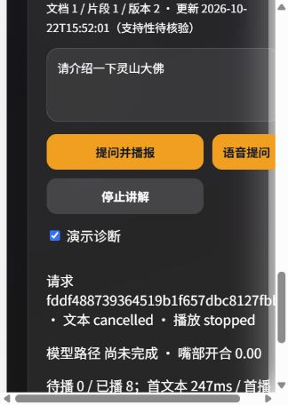

# 灵山胜境 AI 数字人导游

面向第十五届中国软件杯 A5「景区导览服务 AI 数字人」赛题的完整原型。系统以数字人“灵汐”为交互入口，把景区知识检索、受约束的大模型回答、语音识别/合成、Live2D 展示、路线推荐和运营后台串成一条可运行链路。

> 本仓库是团队原型，不是生产服务。当前 RAG 使用 Chroma/local_hash（确定性散列，不是预训练语义嵌入）及词法回退，LLM 可接 DeepSeek/Qwen。推荐先运行下方无 Key 演示：模拟模型、固定音调、SVG 形象；真实语音与模型需要另行配置和验证。

## 已实现能力

- **知识增强问答**：文档上传、解析切分、Chroma 索引、景点名增强检索、低置信度拒答和来源返回。
- **流式数字人讲解**：SSE 增量回答；完整句子进入容量为 4 的队列，逐段合成、播放至 ended 后继续；停止会取消文本、TTS、音频与动画。保留后端有界并行分段 API，但数字人页优先使用简单的逐段路径。
- **双通道模型容错**：按 `LLM_PROVIDER` 选择 DeepSeek 或 Qwen 为主通道；首个有效文本前异常或结束时仅有空白则切换另一通道，两者不可用时回退本地知识库回答。有效文本已经输出后不会切换模型，避免内容拼接。
- **语音与形象**：已有 faster-whisper ASR、edge-tts TTS 适配；当前播放口型由实际音频能量驱动，静音/暂停/结束复位，不是音素同步。语音失败保留文字，不从头重播。默认 SVG；Live2D CDN 需显式启用。
- **游客服务**：景点查询、路线推荐、收藏、历史记录、拍照识景、游客反馈。
- **景区运营**：知识库/景点/数字人配置、行为数据导入、满意度与情绪统计、数据大屏。
- **交付范围**：本地 SQLite 演示与离线回归已验证；保留 Docker Compose/PostgreSQL、PyInstaller 配置，但本轮没有重建容器或 exe。
- **最小访问边界**：管理 API 使用 `X-Admin-Key`；会话、历史和收藏按浏览器游客凭据隔离。不是完整账号系统，不能据此直接公开部署。

## 系统链路

```text
文字 / 麦克风 / 图片
        ↓
FastAPI API ── 会话、路线、反馈与运营数据
        ↓
Chroma 检索 + 景点词增强 + 低置信度边界判断
        ↓
DeepSeek → Qwen → 本地知识库回答
        ↓
SSE 文本流 → 分句 TTS → 顺序播放 → Live2D 口型与字幕
```

降级关系是单向且可解释的：云模型失败不影响本地知识库回答，edge-tts 失败不影响文字展示，Live2D 加载失败不影响 SVG 角色与核心问答。

## 技术栈

| 模块 | 当前实现 |
|---|---|
| 前端 | Vue 3、TypeScript、Vite、Pinia、Element Plus |
| 数字人 | Live2D Cubism Web、Web Audio API、SVG fallback |
| 后端 | FastAPI、SQLAlchemy、Alembic、SSE |
| RAG | Chroma、本地 hash embedding、词法检索与景点名增强 |
| LLM / VLM | DeepSeek 与通义千问 OpenAI-compatible API、Qwen-VL |
| ASR / TTS | faster-whisper、edge-tts；失败时纯文字；离线演示使用固定音调 |
| 数据库 | PostgreSQL（容器）/ SQLite（本地打包） |
| 交付 | Docker Compose、PyInstaller |

## 快速启动

### 推荐：无需模型 Key 的本地演示

Python 3.11/3.13、Node 24；以下从仓库根目录执行。只下载小型工程依赖，不下载 ASR/embedding 模型。

```powershell
python -m venv .venv
.\.venv\Scripts\python.exe -m pip install -r requirements-test.txt
.\.venv\Scripts\python.exe scripts/run_demo.py
```

另开终端：

```powershell
cd frontend
npm ci --ignore-scripts --no-audit --no-fund
npm run dev -- --host 127.0.0.1
```

打开 `http://127.0.0.1:5173/avatar`，问“介绍灵山大佛”，展开“依据”，播放中点“停止讲解”。模拟音调不是中文朗读；诊断面板显示请求和播放状态。默认不加载外部 Live2D CDN。演示启动器不读取 `.env`，强制清空模型 Key、关闭在线预热、禁用 ASR/VLM，并在 `.local-demo/` 建库/迁移/导入 `data/demo/guide.md`。样例不是已核验的官方资料。无需手动索引即可使用 SQL 词法检索。

Linux 将 Python 路径换为 `.venv/bin/python`。`--state-dir <新目录>` 可验证全新数据库流程，`--port` 可换后端端口（前端须同时配置 `VITE_API_BASE_URL`）。[三分钟演示及故障注入](docs/engineering-evidence.md#三分钟演示)。



### 原有 Docker Compose（本轮未实测）

以下不是公开部署指南；先设置自己的数据库密码和管理员密钥，不要沿用示例值。

```powershell
git clone https://github.com/1391363774-lgtm/ai-digital-human-tour-guide.git
cd ai-digital-human-tour-guide
Copy-Item .env.example .env
docker compose up -d --build
```

启动后访问：

- 游客端：`http://localhost:5173`
- 后端接口文档：`http://localhost:8000/docs`
- 健康检查：`http://localhost:8000/health`

模型 Key 均为可选。若需要云端回答，在 `.env` 中至少配置一个：

```dotenv
LLM_PROVIDER=deepseek
DEEPSEEK_API_KEY=
QWEN_API_KEY=
```

### 本地开发

真实服务模式需要完整依赖、资料与网络；本轮没有验证云模型/真实 TTS/ASR。后端 Python 3.11+，推荐前端与 CI 使用同一 Node 24：

```powershell
python -m venv .venv
.\.venv\Scripts\Activate.ps1
pip install -r backend\requirements.txt

Set-Location backend
alembic upgrade head
fastapi dev app\main.py
```

另开一个终端：

```powershell
Set-Location frontend
npm ci --ignore-scripts
npm run dev
```

导入赛题景区资料后可构建索引：

```powershell
python scripts\import_official_data.py --source <资料包.zip> --commit
python scripts\build_index.py
```

## 100 题评测集

仓库提供 100 题中文评测集，覆盖事实、景点介绍、文化背景、跨景点比较、路线、口语化改写和超范围拒答 7 类问题：

```powershell
python scripts\eval_qa_accuracy.py --base-url http://localhost:8000
```

这 100 题是关键词/景点名代理评测，不是 100 个独立 bug，也没有完整的相关片段 ID、来源与人工事实标注。目前没有本轮完整知识库的重新评测结果；历史指标不代表当前版本，不在此展示为现状。真实模式执行评测可能调用付费模型，必须自行确认预算。演示样例仅用于链路验收，不能拿其成绩代表完整景区问答质量。详见 [评测说明](docs/EVALUATION.md)。

另有可移植的 [评测包](评测包/README.txt)，只依赖 Python 标准库，可测试本项目或其他 HTTP 问答接口。

## 离线工程回归

不需要模型 Key、PostgreSQL、Chroma 服务或语音模型：

```powershell
python -m venv .venv
.\.venv\Scripts\python.exe -m pip install -r requirements-test.txt
.\.venv\Scripts\python.exe -m pytest tests/backend -q
.\.venv\Scripts\python.exe scripts/probe_sse_concurrency.py --assert-responsive --output sse-local.json
```

Linux 使用 `.venv/bin/python`。测试包括原有回归、空流备用切换、文本 SSE 并发/取消、知识变更缓存版本与 SQLite 迁移。
GitHub Actions 配置见 `.github/workflows/backend-regression.yml`，本地通过不代表远端 CI 已运行。

升级已有数据库前先备份，在 `backend/` 执行 `alembic upgrade head`（当前至 0006）。0003 是知识版本，0004 是回答终态，0005 是游客隔离，0006 是待清理向量队列。旧无归属会话不会自动归属给任意游客；不删除历史，但游客页不再公开显示它们。
工程变更、证据与运行边界见 [工程交付说明](docs/RELIABILITY_REVIEW.md)，学习验证任务见 [导师练习](docs/MENTORING.md)。
2026-10-22 起的增量工程证据见 [engineering-evidence](docs/engineering-evidence.md)，完成范围见 [progress](docs/progress.md)，讲解与实践见 [interview-guide](docs/interview-guide.md)。迁移 0004 新增回答终态字段；前端使用 `npm ci --ignore-scripts`、`npm test`、`npm run build` 验证。

### 新增配置与兼容性

- `ADMIN_API_KEY`：服务端管理员密钥；未配置时管理接口 503，错误凭据 401。前端管理页密码输入仅存当前页内存。不要使用 `VITE_*` 存密钥，不要提交 `.env`。
- `X-Visitor-Key`：前端自动生成并存 localStorage；HTTP 客户端须提供 32–128 位小写十六进制随机串。它是持有者凭据，不是实名登录；被窃取即可访问对应数据，清除浏览器存储会失去原会话访问权。
- `CORS_ORIGINS`：默认仅 localhost/127.0.0.1:5173；`APP_DEBUG=false`；`TTS_PREWARM=false`（开启会访问在线语音服务）。
- `LLM_READ_TIMEOUT=60` / `LLM_CONNECT_TIMEOUT=10`：异步云模型读取/连接超时（秒）；不是完整问答总时限。
- `DEMO_MODE=false`：正常默认；只在专用演示启动器中打开。故障开关仅适用于单 worker 演示。
- `VITE_LIVE2D_CDN=true`：可选前端配置，启用既有外部 CDN 加载；需要网络及素材/SDK 使用许可，本轮未验证。未设置则稳定使用 SVG。

索引 collection 现含 `local_hash_v1/384` 身份；升级后需管理员执行 `/api/admin/knowledge/rebuild-index` 重建向量。未重建时 SQL 词法检索仍可用。清理失败可重试 `/api/admin/knowledge/cleanup-vectors`；返回 pending 不等于已清空。当前跨进程 SQLite 锁已测，真实 Chroma/PostgreSQL 多 worker 未测。

## 项目结构

```text
backend/                 FastAPI、数据库、RAG、LLM、语音服务
frontend/                Vue 游客端、数字人页与管理后台
ai/prompts/              受约束的景区导游提示词
data/eval/               100 题评测集
scripts/                 数据导入、索引、冒烟测试与评测脚本
评测包/                  独立可移植评测工具
docs/                    架构、部署、演示和评测文档
```

更多接口见 [API.md](API.md)，部署细节见 [DEPLOYMENT.md](DEPLOYMENT.md)，架构说明见 [ARCHITECTURE.md](ARCHITECTURE.md)。

## 团队

- 赛题：第十五届中国软件杯 A5 · 景区导览服务 AI 数字人
- 学校：河南财经政法大学
- 成员：张越政、刘翰
- 指导教师：张潇文

## 使用边界

- 本项目是比赛原型，不应替代景区官方票务、交通、安全或宗教事务说明。
- 票价、开放时间、演出场次等时效信息应以景区官方渠道为准。
- `.env`、真实游客数据、运行数据库和完整评测输出不会提交到仓库。
- 知识库及引用接口用于公开导览资料；不要上传私人或保密文档，当前不是多租户私有知识库。
- Live2D 模型与素材需遵守各自许可；二次发布前请重新核对素材授权。
